<!-- ════════════════════════════════════════════════════════════════ -->
<!--  dwgx.menu  v2.14  ·  generated 2026-11-28 09:53 JST          -->
<!--  source: profile.toml  ·  renderer: scripts/render_profile.py     -->
<!-- ════════════════════════════════════════════════════════════════ -->
<!-- DWGX-ORNAMENT:hero:BEGIN -->
<p align="center">
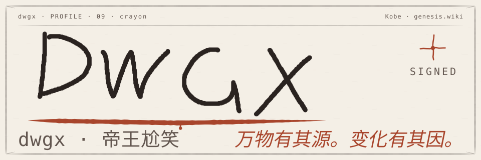
</p>
<!-- DWGX-ORNAMENT:hero:END -->

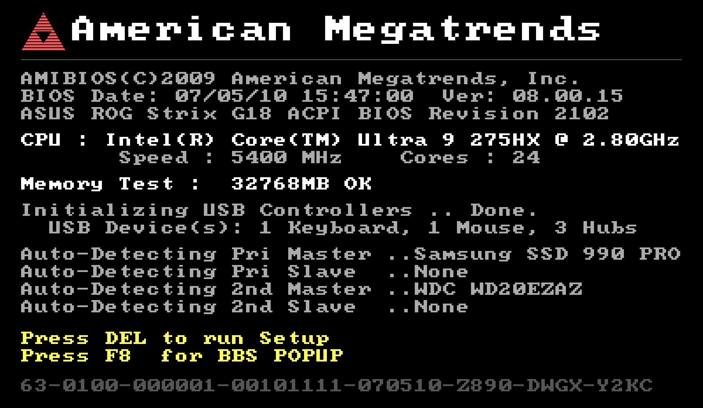

<div align="center">


<br/>

[](https://dwgx.github.io)

<p>
  
  &nbsp;
  
  &nbsp;
  
</p>

<p>
  
  &nbsp;
  
  &nbsp;
  
</p>

</div>

<a name="dwgx-boot-menu"></a>
<!-- DWGX-ORNAMENT:boot-menu:BEGIN -->
<p align="center">
<a href="#user-content-dwgxcfg">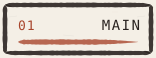</a>
<a href="#user-content-processtable">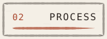</a>
<a href="#user-content-origingenesis">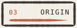</a>
<a href="#user-content-pinned">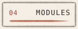</a>
<a href="#user-content-featured">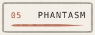</a>
<a href="#user-content-eventlog">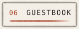</a>
</p>
<!-- DWGX-ORNAMENT:boot-menu:END -->

<p align="center"><samp>〔 <a href="#user-content-dwgxcfg">配置</a> / <a href="#user-content-origingenesis">ORIGIN</a> / <a href="#user-content-pinned">项目</a> / <a href="#user-content-featured">幻想万華鏡</a> / <a href="#user-content-eventlog">留言</a> 〕</samp></p>

---

<!-- DWGX-ORNAMENT:rail-01:BEGIN -->
<p align="center">
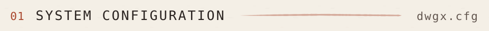
</p>
<!-- DWGX-ORNAMENT:rail-01:END -->

### `dwgx.cfg`

```ini
; 2026-11-28 09:53 JST

[who]
name = dwgx
aka  = 帝王尬笑
from = Kobe
note = 也许我就是dwgx

[ship]
ORIGIN      = genesis.wiki
WindsurfAPI = js · openai/anthropic · v4.0.2
KiroStudio  = rust · kiro gateway · v1.2.5

[also]
other = VRChat RE · SmartCLI
from  = MC clients
```
---

<!-- DWGX-ORNAMENT:rail-02:BEGIN -->
<p align="center">
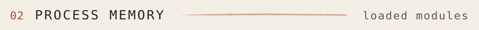
</p>
<!-- DWGX-ORNAMENT:rail-02:END -->

### `process.table`

<div align="center">

<picture>
  <source media="(max-width: 600px)" srcset="https://raw.githubusercontent.com/dwgx/DWGX/main/assets/process-table-mobile.svg?t=1795827223" />
  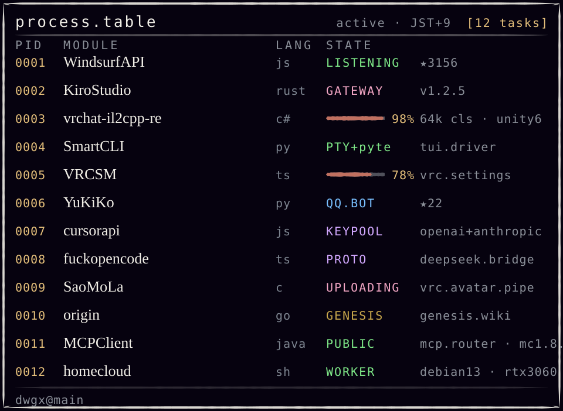
</picture>

</div>

---

### `setup.utility`

<details>
<summary>Boot — 1st ORIGIN · 2nd WindsurfAPI · 3rd KiroStudio</summary>

<p align="center">
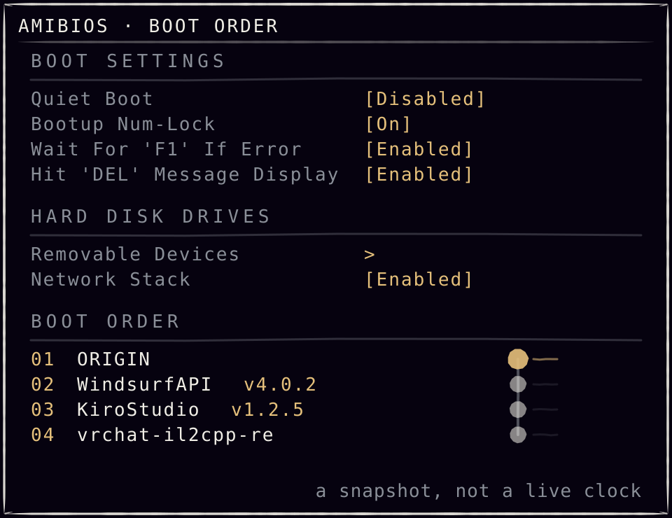
</p>

</details>

---

### `status.pages`

<details>
<summary>Main — last public work · release RDC-Operator-Kit · 1d ago · v0.1.0a5</summary>

<p align="center">
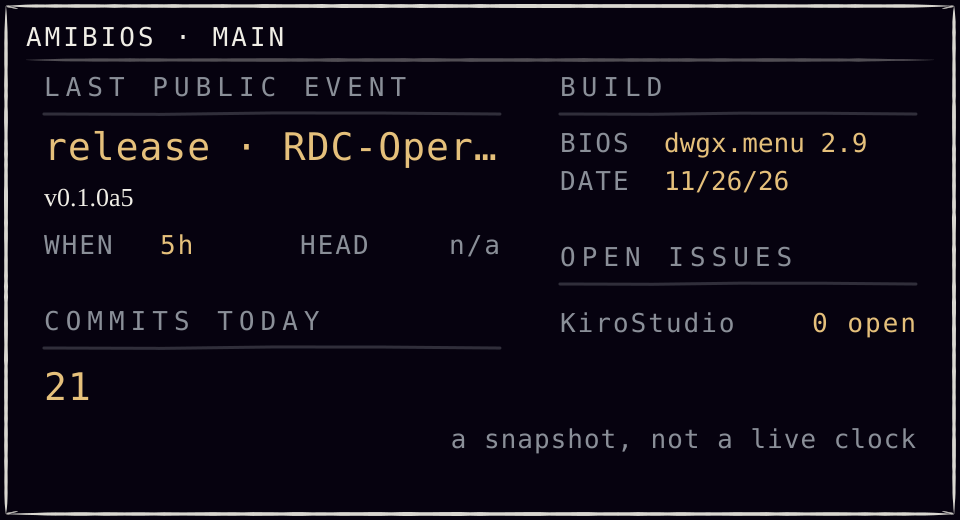
</p>

</details>

<details>
<summary>Advanced — git HEADs as IDE devices</summary>

<p align="center">
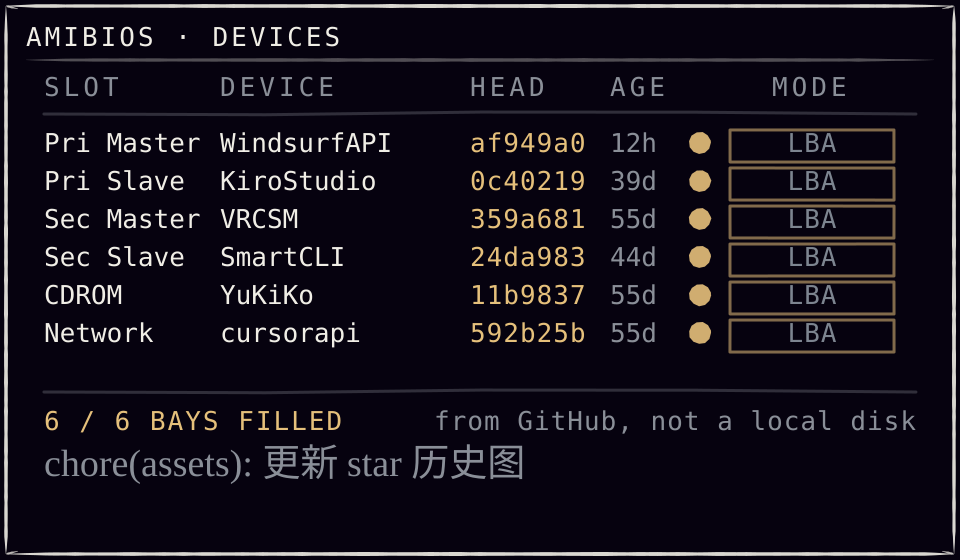
</p>

</details>

<details>
<summary>Log — public events</summary>

<p align="center">
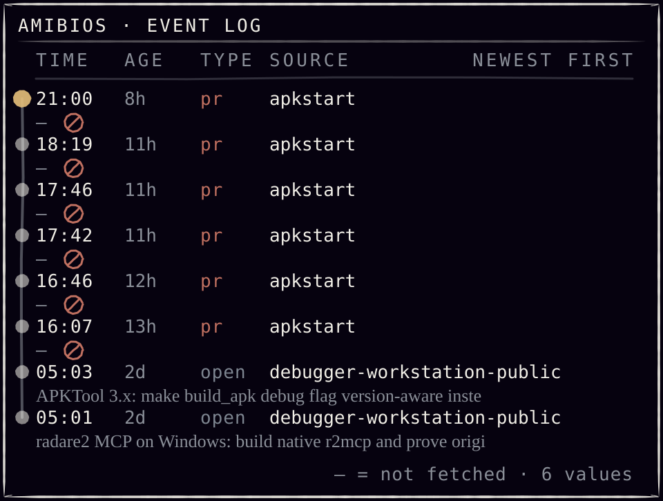
</p>

</details>

---

### `cmos.book`

<details>
<summary>POST — CPU cache · memory test · IDE auto-detect</summary>
<p align="center">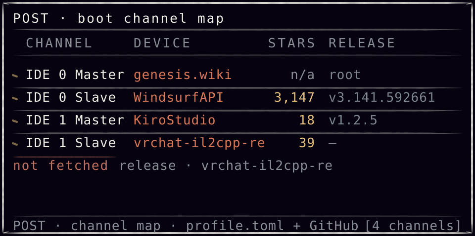</p>
</details>

<details>
<summary>DMI — SMBIOS Type 0 BIOS · Type 1 system · Type 2 ROG · Type 3 Homecloud</summary>
<p align="center">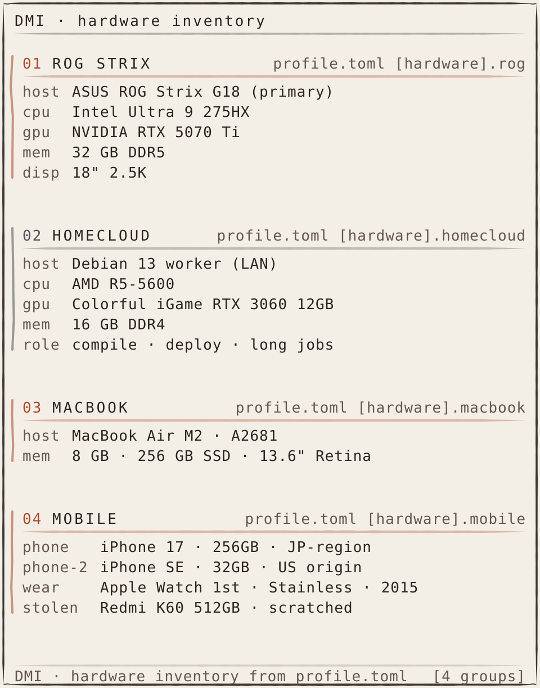</p>
</details>

---

<!-- DWGX-ORNAMENT:rail-03:BEGIN -->
<p align="center">
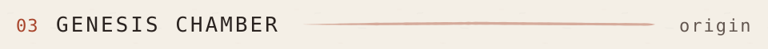
</p>
<!-- DWGX-ORNAMENT:rail-03:END -->

### `origin.genesis`

<div align="center">

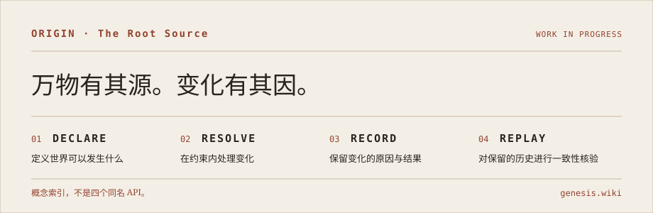

<sub>World protocol · causal history · replay</sub>

*万物有其源。变化有其因。*

</div>

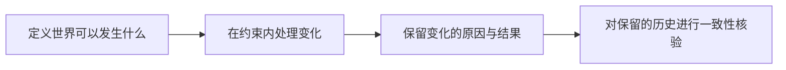

| 概念索引 | 含义 |
| :-- | :-- |
| `DECLARE` | 定义世界可以发生什么 |
| `RESOLVE` | 在约束内处理变化 |
| `RECORD` | 保留变化的原因与结果 |
| `REPLAY` | 对保留的历史进行一致性核验 |

我正在构建一套世界协议与参考运行时。先声明法则、时间和初始条件，再让变化在这些约束里发生，留下原因、依据与结果。

模型可以参与观察和决策，但输出本身不是世界事实。叙事应该解释发生过的事情，而不是反过来改写它。

这四项是介绍用的概念索引，不是四个同名 API，也不是固定调用顺序。

<details>
<summary>当前在推进什么 / 更远的方向</summary>

当前围绕世界声明、执行内核、因果记录和重放核验推进。更完整的生命、生态、社会与文明演化，是继续研究的方向，不是已完成的功能清单。

我希望历史来自规则、资源、时间与相互作用，而不是预先写好的剧情。重放核验能检查执行一致性，本身不证明世界模型符合现实。

</details>

[打开 genesis.wiki →](https://genesis.wiki)

---

<!-- DWGX-ORNAMENT:rail-04:BEGIN -->
<p align="center">
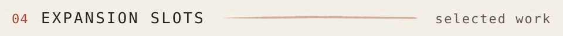
</p>
<!-- DWGX-ORNAMENT:rail-04:END -->

<div align="center">

### `pinned`

<table>
<tr>
<td width="50%" valign="top" align="left">
<p><samp>01 / 逆向笔记</samp></p>
<h4><a href="https://github.com/dwgx/vrchat-il2cpp-re">vrchat-il2cpp-re</a></h4>
<p>VRChat IL2CPP 结构与逆向笔记：类、方法、字段索引。</p>
<p><code>classes</code> <code>methods</code> <code>fields</code><br /><sub>Unity / IL2CPP · C# · ★40</sub></p>
<p><a href="https://github.com/dwgx/vrchat-il2cpp-re">打开项目 →</a></p>
</td>
<td width="50%" valign="top" align="left">
<p><samp>02 / 协议网关</samp></p>
<h4><a href="https://github.com/dwgx/KiroStudio">KiroStudio</a></h4>
<p>Kiro / AWS Q 网关，支持 Anthropic Messages、凭据池和管理面板。</p>
<p><samp>Messages → Gateway → Kiro</samp><br /><sub>proto-bridge + pool · Rust · ★18 · v1.2.5</sub></p>
<p><a href="https://github.com/dwgx/KiroStudio">打开项目 →</a></p>
</td>
</tr>
<tr>
<td width="50%" valign="top" align="left">
<p><samp>03 / 接口适配</samp></p>
<h4><a href="https://github.com/dwgx/WindsurfAPI">WindsurfAPI</a></h4>
<p>Windsurf / Devin 多协议网关：Chat、Responses、Messages、Gemini。</p>
<p><code>Chat</code> · <code>Responses</code> · <code>Messages</code> · <code>Gemini</code><br /><sub>multi-protocol · zero-dep · JavaScript · ★3,163 · v4.0.2</sub></p>
<p><a href="https://github.com/dwgx/WindsurfAPI">打开项目 →</a></p>
</td>
<td width="50%" valign="top" align="left">
<p><samp>04 / 终端工具</samp></p>
<h4><a href="https://github.com/dwgx/SmartCLI">SmartCLI</a></h4>
<p>读取终端画面，执行操作，再检查结果。PTY + pyte。</p>
<p><samp>$ read → act → confirm</samp><br /><sub>PTY + pyte · Python · ★5</sub></p>
<p><a href="https://github.com/dwgx/SmartCLI">打开项目 →</a></p>
</td>
</tr>
<tr>
<td width="50%" valign="top" align="left">
<p><samp>05 / 内核门控</samp></p>
<h4><a href="https://github.com/dwgx/MCPClient">MCPClient</a></h4>
<p>Minecraft 1.8.9 的 MCP 接口，带 7 层 NT 风格权限内核。</p>
<p><code>mc.1.8.9 client</code><br /><code>mcp.server</code><br /><code>nt.kernel 7L</code><br /><sub>MCP · Java · Java · ★3</sub></p>
<p><a href="https://github.com/dwgx/MCPClient">打开项目 →</a></p>
</td>
<td width="50%" valign="top" align="left">
<p><samp>06 / 桌面工具</samp></p>
<h4><a href="https://github.com/dwgx/VRCSM">VRCSM</a></h4>
<p>VRChat 缓存与配置管理，Windows 桌面工具。</p>
<p><samp>cache / config / desktop</samp><br /><sub>VRChat / Windows · C++ / TypeScript · ★5 · v0.16.5</sub></p>
<p><a href="https://github.com/dwgx/VRCSM">打开项目 →</a></p>
</td>
</tr>
</table>

[120 public repos · 3,658 stars · browse all →](https://github.com/dwgx?tab=repositories)

</div>

<details>
<summary>ASCII 卡片 · 归档</summary>

<table>
<tr>
<td width="33%" valign="top">

```
╔══════════════════════════╗
║ vrchat-il2cpp-re         ║
╠══════════════════════════╣
║                          ║
║  64K classes             ║
║  570K methods · 188K fld ║
║  Unity 6 baseline RE     ║
║                          ║
║  lang  · C#              ║
║  stage · live            ║
║  diff  · ★★★★☆           ║
╚══════════════════════════╝
```

</td>
<td width="33%" valign="top">

```
╔══════════════════════════╗
║ KiroStudio               ║
╠══════════════════════════╣
║                          ║
║  Kiro unified gateway    ║
║  proto-bridge + pool     ║
║  Rust + SQLite + Docker  ║
║                          ║
║  lang  · Rust            ║
║  stage · shipping        ║
║  diff  · ★★★★☆           ║
╚══════════════════════════╝
```

</td>
<td width="33%" valign="top">

```
╔══════════════════════════╗
║ WindsurfAPI              ║
╠══════════════════════════╣
║                          ║
║  Windsurf ⇄ OpenAI       ║
║  100+ models · 3 APIs    ║
║  zero-dep self-host      ║
║                          ║
║  lang  · JavaScript      ║
║  stage · flagship        ║
║  diff  · ★★☆☆☆           ║
╚══════════════════════════╝
```

</td>
</tr>
<tr>
<td width="33%" valign="top">

```
╔══════════════════════════╗
║ SmartCLI                 ║
╠══════════════════════════╣
║                          ║
║  3 agent skills · 1 PTY  ║
║  pyte cell-accurate TUI  ║
║  pip smartcli-toolkit    ║
║                          ║
║  lang  · Python          ║
║  stage · shipped         ║
║  diff  · ★★★☆☆           ║
╚══════════════════════════╝
```

</td>
<td width="33%" valign="top">

```
╔══════════════════════════╗
║ MCPClient                ║
╠══════════════════════════╣
║                          ║
║  Live MC 1.8.9 client    ║
║  MCP surface for LLMs    ║
║  7-layer NT kernel       ║
║                          ║
║  lang  · Java            ║
║  stage · public          ║
║  diff  · ★★☆☆☆           ║
╚══════════════════════════╝
```

</td>
<td width="33%" valign="top">

```
╔══════════════════════════╗
║ VRCSM                    ║
╠══════════════════════════╣
║                          ║
║  VRChat cache / config   ║
║  Windows desktop app     ║
║  C++20 + WebView2 + TS   ║
║                          ║
║  lang  · C++ / TypeScript║
║  stage · shipping        ║
║  diff  · ★★★☆☆           ║
╚══════════════════════════╝
```

</td>
</tr>
</table>

</details>

---

### `demo.deck`

<p align="center"><a href="https://github.com/dwgx/SmartCLI#driving-a-real-tui">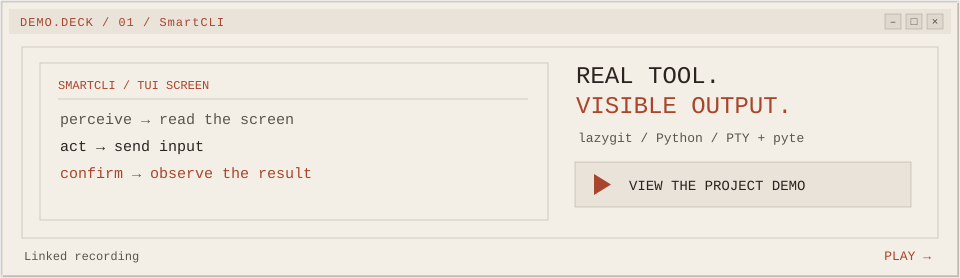</a></p>

<details>
<summary>PLAY 01 · lazygit</summary>

<p align="center"><a href="https://github.com/dwgx/SmartCLI#driving-a-real-tui"></a></p>

</details>

---

### `recent.log`

```
 2026-11-26 08:00  push  WindsurfAPI            ★3163  js     Turn Windsurf / Devin Desktop's 100+ AI m…
 2026-11-26 17:31  rel   RDC-Operator-Kit       ★0     py     Windows-first desktop and terminal adapte…
 2026-11-21 16:10  push  apkstart               ★0     js     Windows 上的安卓应用运行器：双击 APK 即装，应用以独立窗口与桌面图标运…
 2026-11-20 04:48  push  debugger-workstation-public ★4     py     Portable reverse-engineering / security-a…
 2026-11-17 21:55  push  designers-brain        ★2     py     A brain for designers — distilling artist…
 2026-11-09 20:27  push  AgentRule              ★2     sh     一套给 agent 的规则书，和把它装进去的部署协议。中文。omp / Codex…
 2026-11-04 21:29  push  VCC_I18N               ★2     rust   Standalone Windows launcher that localize…
 2026-11-05 02:29  rel   kozi                   ★1     java   帝王尬笑模拟扣字机 — Java Swing 聊天扣字模拟器
 2026-11-15 20:17  push  ung220z-tool           ★44    -      本仓库仅为个人学习、技术研究及开源存档而 Fork，不代表本人参与原项目开发或认可…
 2026-11-02 07:27  push  VirtualDesktopHelper   ★2     c#     Virtual Desktop 串流检测/诊断/修复工具：PC 侧网络体检 + S…
```

---

<!-- DWGX-ORNAMENT:rail-05:BEGIN -->
<p align="center">
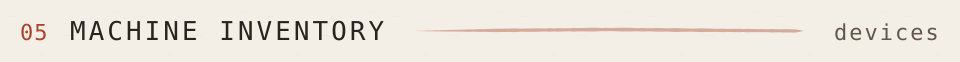
</p>
<!-- DWGX-ORNAMENT:rail-05:END -->

<!-- DWGX-ORNAMENT:io-panel:BEGIN -->
<p align="center">
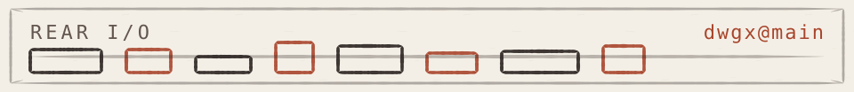
</p>
<!-- DWGX-ORNAMENT:io-panel:END -->

### `hardware.dmp`

```
               ╭─── dwgx@main ──────────────────────────────────╮
               │                                                │
 ROG Strix ════╡  host       ASUS ROG Strix G18  (primary)      │
               │  cpu        Intel Ultra 9 275HX                │
               │  gpu        NVIDIA RTX 5070 Ti                 │
               │  mem        32 GB DDR5                         │
               │  disp       18"  2.5K                          │
               │                                                │
 Homecloud ════╡  host       Debian 13 worker  (LAN)            │
               │  cpu        AMD R5-5600                        │
               │  gpu        Colorful iGame RTX 3060 12GB       │
               │  mem        16 GB DDR4                         │
               │  role       compile · deploy · long jobs       │
               │                                                │
 MacBook ══════╡  host       MacBook Air M2 · A2681             │
               │  mem        8 GB · 256 GB SSD · 13.6" Retina   │
               │                                                │
 Mobile ═══════╡  phone      iPhone 17 · 256GB · JP-region      │
               │  phone-2    iPhone SE · 32GB · US origin       │
               │  wear       Apple Watch 1st · Stainless · 2015 │
               │  ; stolen     Redmi K60 512GB · scratched      │
               │                                                │
 Peripheral ═══╡  kbd        VGN FLASH Ultra 太陽神 · mag-switch│
               │  mouse      VGN Dragonfly 3 Master 超跑紅 · 56g│
               │  mouse-2    VGN Dragonfly King · 太空银        │
               │  audio      AirPods Pro 3 · Panasonic SL-CT790 │
               │  vr         Meta Quest 3                       │
               │                                                │
               │  uptime     5990 days                          │
               │  status     online · JST+9                     │
               ╰────────────────────────────────────────────────╯
```

---

<div align="center">

### `discord.presence`

<a href="https://discord.com/users/1284670281926967336">
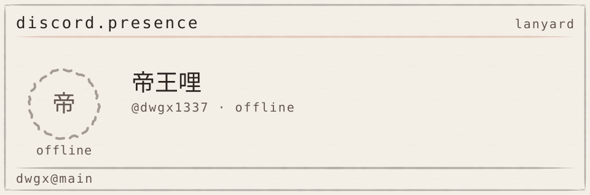
</a>

<br/>

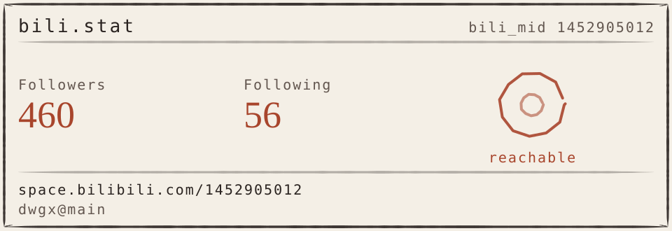

</div>

---

<div align="center">

### `media.aux`

<!-- DWGX-ORNAMENT:media-aux:BEGIN -->
<p align="center">
<a href="https://github.com/dwgx/NewAppleMusicPlayer">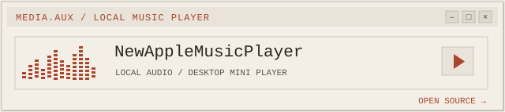</a>
</p>
<!-- DWGX-ORNAMENT:media-aux:END -->

</div>

---

<!-- DWGX-ORNAMENT:rail-06:BEGIN -->
<p align="center">
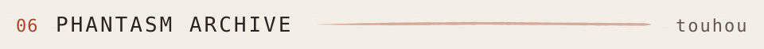
</p>
<!-- DWGX-ORNAMENT:rail-06:END -->

<!-- DWGX-ORNAMENT:phantasm:BEGIN -->
<p align="center">
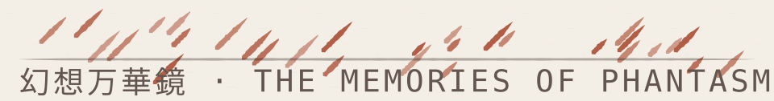
</p>
<!-- DWGX-ORNAMENT:phantasm:END -->

<div align="center">

### `featured`

## 幻想万華鏡 ~ The Memories of Phantasm


<br/>

<sub>滿福神社製作  ·  全18話  ·  BDRip  ·  東方Project 二次創作</sub>

<br/><br/>


<br/><br/>

[影像 / 作品 →](https://space.bilibili.com/1452905012) · [演示 / 留档 →](https://www.youtube.com/@dwgx1337)

</div>

---

<!-- ════════════════════════════════════════════════════════════════ -->
<!--  style switch: scene-nfo release note                            -->
<!-- ════════════════════════════════════════════════════════════════ -->

<div align="center">

### `stack`

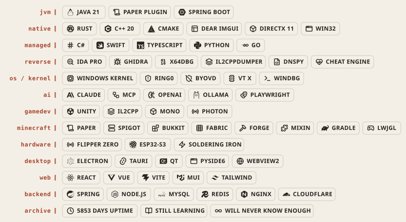

</div>

---

### `achievements`

<div align="center">


<br/>


<br/>


</div>

---

<!-- DWGX-ORNAMENT:rail-07:BEGIN -->
<p align="center">
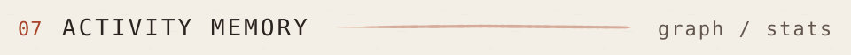
</p>
<!-- DWGX-ORNAMENT:rail-07:END -->


---

### `stats`

<div align="center">

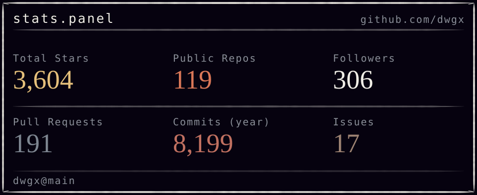
&nbsp;&nbsp;
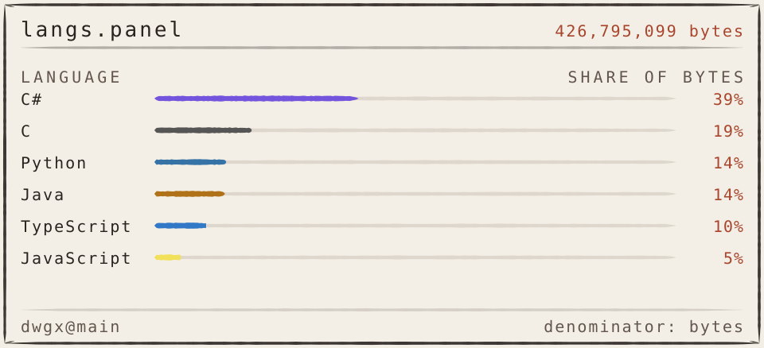

</div>

---

### `contribution.memory`

<div align="center">

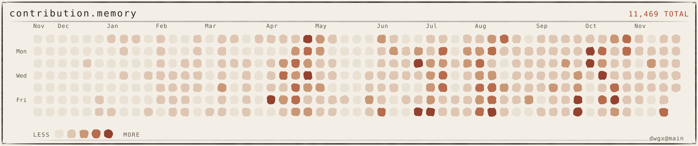

<a href="https://github.com/dwgx?tab=overview">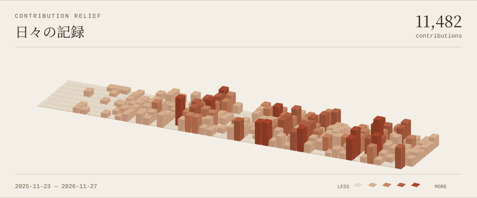</a>

<details>
<summary>3D archive · seasonal / night</summary>

<picture>
  <source media="(prefers-color-scheme: dark)" srcset="https://raw.githubusercontent.com/dwgx/DWGX/main/profile-3d-contrib/profile-night-view.svg?t=1795827223" />
  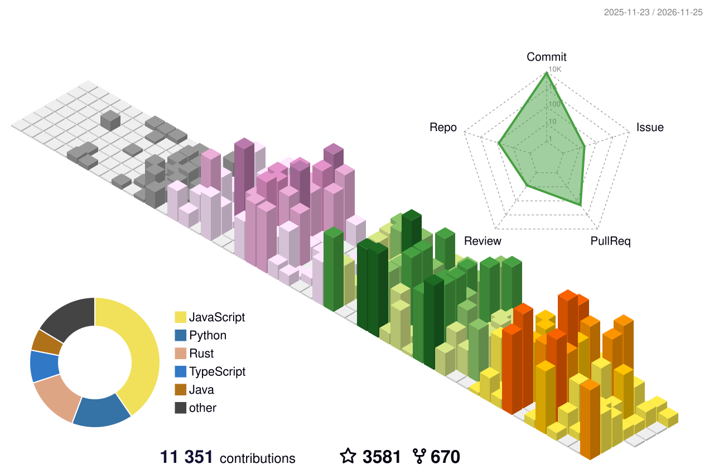
</picture>

</details>

</div>

---

### `hex.dump`

```
 00401000  e5 b8 9d e7 8e 8b e5 b0   ac e7 ac 91 00 00 00 00   帝王尬笑
 00401010  6d 61 79 62 65 20 49 27   6d 20 64 77 67 78 00 00   maybe I'm dwgx
 00401020  67 65 6e 65 73 69 73 2e   77 69 6b 69 00 00 00 00   genesis.wiki
 00401030  e5 b9 bb e6 83 b3 e4 b8   87 e8 8f af e9 8f a1 00   幻想万華鏡
 00401040  57 69 6e 64 73 75 72 66   41 50 49 00 00 00 00 00   WindsurfAPI
 00401050  69 6e 64 65 70 2e 32 30   31 30 00 00 00 00 00 00   indep.2010
```

---

### `hotkeys`

<p align="center">
<a href="https://dwgx.github.io">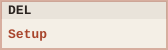</a>
<a href="https://genesis.wiki">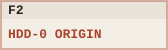</a>
<a href="https://www.youtube.com/@dwgx1337"></a>
<a href="https://space.bilibili.com/1452905012">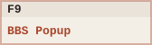</a>
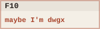
</p>

### `field.notes`

<p align="center">
<a href="https://blog.dwgx.top">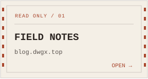</a>
<a href="https://dwgx.github.io/WindsurfAPI/HISTORY-LEDGER-VIZ.html">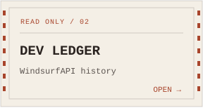</a>
<a href="https://genesis.wiki">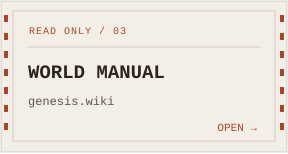</a>
</p>
<p align="center"><sub>笔记 · 开发记录 · 世界文档</sub></p>

<!-- DWGX-ORNAMENT:rail-08:BEGIN -->
<p align="center">
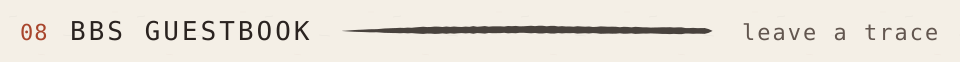
</p>
<!-- DWGX-ORNAMENT:rail-08:END -->

### `event.log`

<p align="center">
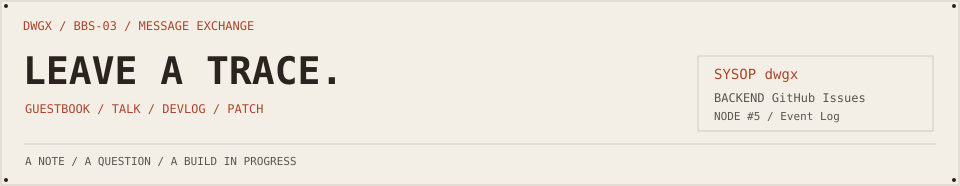
</p>

<p align="center">
<a href="https://github.com/dwgx/DWGX/issues/5#issuecomment-new">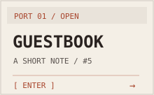</a>
<a href="https://github.com/dwgx/DWGX/issues">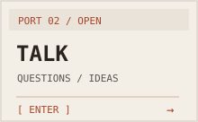</a>
<a href="https://github.com/dwgx/DWGX/issues">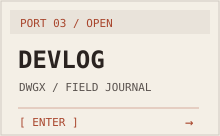</a>
<a href="https://github.com/dwgx/DWGX/pulls">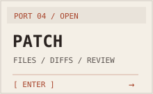</a>
</p>

留言，讨论，还有边做边写的记录。

| 频道 | 放什么 | 入口 |
| :-- | :-- | :-- |
| `GUESTBOOK` | 留一句话 | [回复 #5](https://github.com/dwgx/DWGX/issues/5#issuecomment-new) |
| `TALK` | 聊问题、交换想法 | [打开 Issues](https://github.com/dwgx/DWGX/issues) |
| `DEVLOG` | 开发记录 | [在 Issues 里写一篇](https://github.com/dwgx/DWGX/issues) |
| `PATCHES` | 改动与审阅 | [主页仓库的 PR](https://github.com/dwgx/DWGX/pulls) |

<details>
<summary>写 DEVLOG / 使用约定</summary>

一个问题或一个阶段开一篇：写清这次想解决什么、改了什么、看到了什么结果、还不确定什么。代码改动留在所属项目仓库，这里链接原 PR 或做复盘。

留言正文在 GitHub 原帖阅读，首页不自动搬运每一条。所有内容公开，请不要贴密钥与私人资料。

</details>

[打开 Event Log #5](https://github.com/dwgx/DWGX/issues/5)

<p align="center">
<a href="https://github.com/dwgx/DWGX/issues/5#issuecomment-new">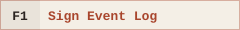</a>
</p>

<p align="center">

</p>


<p align="center">


</p>

<p align="center">


</p>
<p align="center">
<a href="#user-content-dwgx-boot-menu"></a>
</p>
